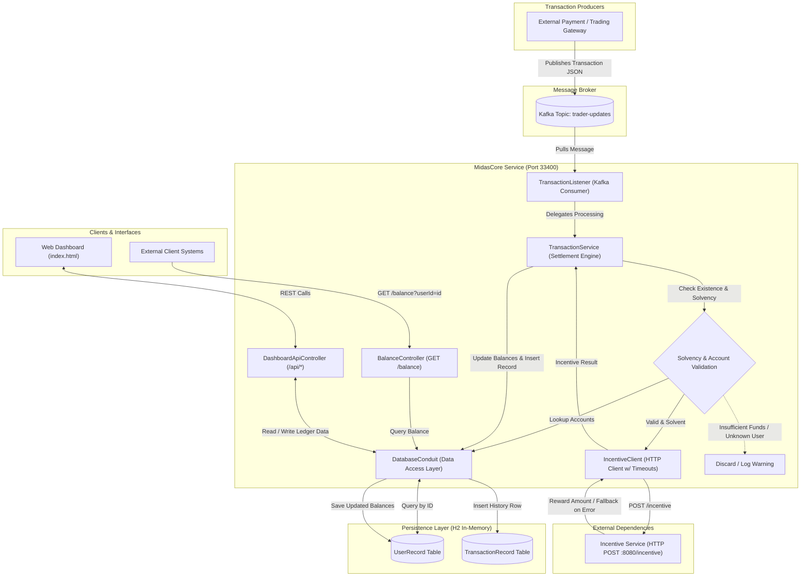
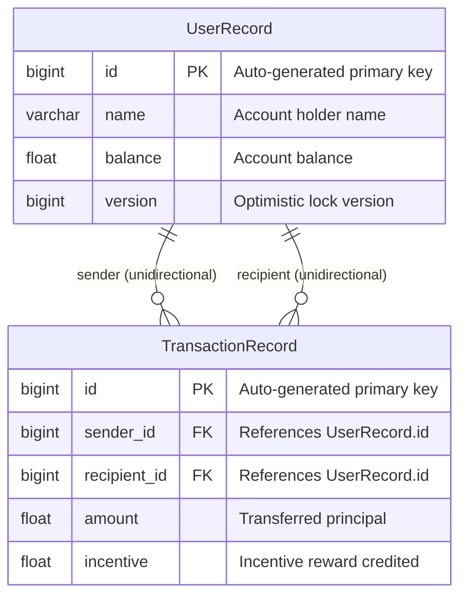
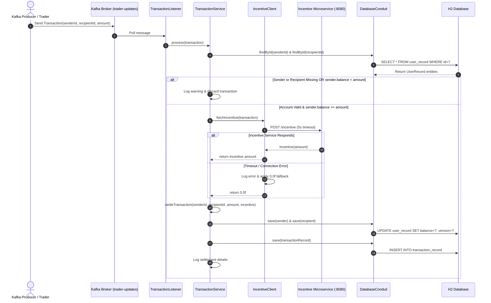

# MidasCore – Financial Transaction Processing System


An event-driven financial transaction processing backend built with **Java 17**, **Spring Boot**, and **Apache Kafka**. The system consumes financial transaction events asynchronously, executes account solvency and existence validations, coordinates promotional reward calculations with a downstream incentive microservice, updates user account balances, and records transaction history in a relational database.

---

## Program Attribution & Context

This project is developed as part of the **JPMorgan Chase & Co. Software Engineering Virtual Experience Program** hosted on Forage (`com.jpmc.midascore`).

- **Foundational Architecture & Specifications**: The initial system requirements, domain model interfaces (`Transaction`, `UserRecord`), sample transaction test data, and the standalone mock incentive microservice (`services/transaction-incentive-api.jar`) were provided by JPMorgan Chase & Co. as part of the engineering program.
- **Engineering Implementation & Enhancements**: The Kafka consumer integration (`TransactionListener`), business validation and solvency checks, outbound HTTP client with timeout handling (`IncentiveClient`), balance settlement logic (`TransactionService`), database access layer (`DatabaseConduit`), REST balance inquiry endpoint (`BalanceController`), interactive dashboard UI and REST APIs (`DashboardApiController`, `index.html`), containerization (`Dockerfile`, `docker-compose.yml`), and automated CI pipeline (`.github/workflows/ci.yml`) were engineered to fulfill and extend the program's technical milestones.

---

## Table of Contents

- [Overview](#overview)
- [System Architecture](#system-architecture)
- [Implemented Features](#implemented-features)
- [Technical Findings & Architectural Nuances](#technical-findings--architectural-nuances)
- [Technology Stack](#technology-stack)
- [Data Model & Schema Design](#data-model--schema-design)
- [API Specifications](#api-specifications)
- [Transaction Lifecycle](#transaction-lifecycle)
- [Project Directory Structure](#project-directory-structure)
- [Getting Started](#getting-started)
  - [Prerequisites](#prerequisites)
  - [1. Configure Environment](#1-configure-environment)
  - [2. Start the External Incentive Service](#2-start-the-external-incentive-service)
  - [3. Build the Application](#3-build-the-application)
  - [4. Run the Application](#4-run-the-application)
  - [5. Run with Docker Compose (Full Stack)](#5-run-with-docker-compose-full-stack)
- [Interactive Web Dashboard](#interactive-web-dashboard)
- [CI/CD Automation Pipeline](#cicd-automation-pipeline)
- [Integration Testing & Verification](#integration-testing--verification)
- [Future Enhancements](#future-enhancements)
- [License](#license)

---

## Overview

In financial processing systems, separating transaction intake from backend ledger updates prevents message loss and isolates processing delays. **MidasCore** functions as an asynchronous transaction ingestion and settlement service.

The service reads transaction messages from an **Apache Kafka** topic (`trader-updates`). For each incoming transaction, MidasCore:
1. Validates account existence for both sender and recipient in the relational database.
2. Performs a pre-settlement solvency check to confirm that the sender has sufficient cleared funds (`sender.balance >= transaction.amount`).
3. Queries an external HTTP incentive microservice to calculate promotional rewards.
4. Updates sender and recipient account balances.
5. Persists a `TransactionRecord` row containing foreign key references to the participating accounts, the transferred principal, and the incentive reward amount.

Additionally, the service exposes an HTTP REST endpoint allowing client applications to query user balances in real time.

---

## System Architecture



---

## Implemented Features

### 1. Asynchronous Kafka Event Ingestion
- Listens to the configured Kafka topic (`trader-updates`) using Spring Kafka's `@KafkaListener`.
- Operates within consumer group `midas-group` with `auto-offset-reset: earliest`.
- Deserializes JSON payloads into typed domain entities (`com.jpmc.midascore.foundation.Transaction`).

### 2. Account Existence & Solvency Verification
- **Account Verification**: Confirms that both sender and recipient user IDs exist in the database before processing.
- **Solvency Check**: Checks that the sender's balance is greater than or equal to the transaction amount (`sender.balance >= transaction.amount`).
- **Validation Discard**: Discards invalid transactions without terminating the consumer loop, logging a descriptive warning.

### 3. Outbound Incentive Microservice Integration
- Dispatches HTTP POST requests to the downstream Incentive Microservice (`http://localhost:8080/incentive`) via Spring's `RestTemplate`.
- **Configured Timeouts**: Connection and read timeouts are set to 5000 ms via `RestTemplateConfig`.
- **Fault-Tolerant Fallback**: Catches network and HTTP exceptions (`Exception`), logs the error, and defaults to `0.0f` incentive. Transaction settlement proceeds without blocking on third-party service downtime.
- **Recipient Credit**: Any returned incentive reward is added directly to the recipient's balance alongside the transfer principal.

### 4. Account Balance Updates & Transaction History
- Updates account balances by deducting the principal from the sender and adding the principal plus incentive to the recipient.
- Inserts a `TransactionRecord` row linking to the sender and recipient via `@ManyToOne` foreign keys, storing `amount` and `incentive`.
- Includes an `@Version` column on `UserRecord` to detect concurrent write conflicts.

### 5. REST Balance Inquiry Endpoint
- Provides `GET /balance?userId={id}` on port `33400`.
- Returns a JSON object with the user's cleared balance (`{"amount": <float>}`).
- Returns `{"amount": 0.0}` when the queried user ID does not exist in the database.

### 6. Interactive Web Dashboard & Helper APIs
- Embedded single-page financial dashboard served at `http://localhost:33400/`.
- Companion REST endpoints under `/api`:
  - `GET /api/users`: Lists registered account holders, balances, and version numbers.
  - `GET /api/transactions/history`: Returns transaction history in reverse chronological order.
  - `POST /api/transactions`: Submits a transaction directly for validation and settlement.
  - `POST /api/users/seed`: Populates initial test accounts when the database is empty.

### 7. Containerization & CI Automation
- Multi-stage `Dockerfile` producing a lean, unprivileged JRE runtime container.
- `docker-compose.yml` orchestrating Apache Kafka (KRaft mode), the mock Incentive Microservice, and MidasCore.
- GitHub Actions CI workflow (`.github/workflows/ci.yml`) building the application and running tests on every push and pull request.

---

## Technical Findings & Architectural Nuances

### 1. Spring AOP Proxy Self-Invocation and `@Transactional`
In `TransactionService.java`, transaction processing is structured as follows:
```java
public void process(Transaction transaction) {
    // 1. Validation & Solvency checks
    // 2. Outbound HTTP incentive call
    settleTransaction(...); // Internal method call on 'this'
}

@Transactional
public void settleTransaction(long senderId, long recipientId, float amount, float incentiveAmount) {
    // Balance mutations and transaction record persistence
}
```
- **Finding**: Because `process(...)` calls `settleTransaction(...)` directly through `this`, the call bypasses Spring's AOP proxy. In standard Spring proxy-based AOP, `@Transactional` is only intercepted when called through an injected bean reference from an external caller.
- **Implication**: As implemented, `settleTransaction` does not open a single wrapping database transaction when invoked from `process(...)`. Instead, each `databaseConduit.save(...)` invocation relies on individual repository-level transactions.
- **Remediation Path**: To enforce atomic rollback across sender, recipient, and transaction record writes, `settleTransaction` should either be moved to a separate Spring-managed service bean or `process` itself should be refactored within a transactional boundary.

### 2. Accounting Model: Direct Balance Transfer vs. Double-Entry
- The application updates account balances directly:
  $$\text{sender.balance} \leftarrow \text{sender.balance} - \text{amount}$$
  $$\text{recipient.balance} \leftarrow \text{recipient.balance} + \text{amount} + \text{incentive}$$
- **Finding**: This is a **dual-party direct balance update model**, not true double-entry bookkeeping.
- **Distinction**: True double-entry accounting requires balanced ledger entries ($\sum \text{Debits} = \sum \text{Credits}$) against an explicit chart of accounts. In this implementation, the promotional incentive is credited to the recipient without a corresponding debit entry to a promotional expense or reserve account.

### 3. Currency Data Type Representation
- Monetary balances, transaction amounts, and incentives are currently represented using IEEE-754 single-precision floating-point numbers (`float`).
- **Limitation**: Binary floating-point arithmetic can introduce decimal rounding inaccuracies over repeated operations. Production financial ledgers require fixed-point arbitrary-precision arithmetic (`BigDecimal`) or integer minor units (cents/basis points).

---

## Technology Stack

| Layer | Technology | Version | Purpose |
| :--- | :--- | :--- | :--- |
| **Language & Runtime** | Java (OpenJDK) | 17+ (tested through JDK 23) | Core programming language |
| **Framework** | Spring Boot | 3.2.5 | Application framework & dependency injection |
| **Messaging** | Apache Kafka / Spring Kafka | 3.1.4 | Asynchronous transaction event streaming |
| **Data Persistence** | Spring Data JPA / Hibernate | 6.4.4 | ORM mapping and entity persistence |
| **Database** | H2 Database Engine | 2.2.224 | In-memory relational database for development and testing |
| **HTTP Client** | Spring Web `RestTemplate` | 3.2.5 | Synchronous HTTP communication with Incentive API |
| **Testing** | JUnit 5 & Spring Boot Test | 5.x / 3.2.5 | Unit, integration, and application context testing |
| **Embedded Testing** | Spring Kafka Test | 3.1.4 | In-process Kafka broker for automated tests |
| **Build & Tooling** | Apache Maven Wrapper | 3.8+ | Dependency management and build packaging |
| **Containerization** | Docker & Docker Compose | Compose v2 | Local container orchestration |

---

## Data Model & Schema Design



### Relational Entity Details

1. **`UserRecord` (`entity/UserRecord.java`)**:
   - `id` (`long`, `@Id @GeneratedValue`): Unique primary key.
   - `name` (`String`, `nullable = false`): Account owner identifier.
   - `balance` (`float`, `nullable = false`): Current balance.
   - `version` (`Long`, `@Version`): JPA optimistic locking version attribute.
   - *Note*: `UserRecord` does not declare a bidirectional `@OneToMany` collection for transactions; relationships are mapped unidirectionally from `TransactionRecord`.

2. **`TransactionRecord` (`entity/TransactionRecord.java`)**:
   - `id` (`Long`, `@Id @GeneratedValue(strategy = GenerationType.AUTO)`): Unique record identifier.
   - `sender` (`@ManyToOne`, `@JoinColumn(name = "sender_id", nullable = false)`): Relational link to the debit account.
   - `recipient` (`@ManyToOne`, `@JoinColumn(name = "recipient_id", nullable = false)`): Relational link to the credit account.
   - `amount` (`float`, `nullable = false`): Base transfer amount.
   - `incentive` (`float`, `nullable = false`): Promotional reward amount credited to recipient.

---

## API Specifications

### 1. Balance Inquiry Endpoint

Retrieves the current balance for a specified user account.

- **Method**: `GET`
- **URL**: `http://localhost:33400/balance`
- **Query Parameter**:
  - `userId` (required, `long`): The account identifier.

#### Example Request
```bash
curl -X GET "http://localhost:33400/balance?userId=5"
```

#### Example Response (User Found – HTTP 200 OK)
```json
{
  "amount": 627.86
}
```

#### Example Response (User Not Found – HTTP 200 OK)
```json
{
  "amount": 0.0
}
```

---

### 2. External Incentive Microservice Contract

Outbound request dispatched by `IncentiveClient` during transaction processing.

- **Method**: `POST`
- **Target URL**: `http://localhost:8080/incentive` (configurable via `services.incentive-api.url`)
- **Headers**: `Content-Type: application/json`

#### Request Payload (`Transaction`)
```json
{
  "senderId": 5,
  "recipientId": 2,
  "amount": 42.87
}
```

#### Expected Response Payload (`Incentive` – HTTP 200 OK)
```json
{
  "amount": 4.28
}
```

*If the incentive service returns an error, times out after 5000 ms, or is unreachable, `IncentiveClient` catches the exception and returns `0.0f`.*

---

### 3. Dashboard & Management REST Endpoints

Implemented in `DashboardApiController` (`/api`) to support the embedded web dashboard:

| Endpoint | Method | Description | Sample Output |
| :--- | :--- | :--- | :--- |
| **`/api/users`** | `GET` | Returns list of all accounts with balances and versions. | `[{"id": 1, "name": "bernie", "balance": 1200.23, "version": 0}]` |
| **`/api/transactions/history`** | `GET` | Returns transaction records in reverse chronological order. | `[{"id": 1, "sender": {...}, "recipient": {...}, "amount": 50.0, "incentive": 5.0}]` |
| **`/api/transactions`** | `POST` | Submits a transaction directly for validation and settlement. | `{"success": true, "message": "Transaction settled successfully.", "senderNewBalance": 1050.23, "recipientNewBalance": 2365.37}` |
| **`/api/users/seed`** | `POST` | Seeds 11 standard test accounts if the table is empty. | `{"seeded": true, "message": "Seeded 11 standard ledger accounts.", "users": [...]}` |

---

## Transaction Lifecycle



---

## Project Directory Structure

```text
MidasCore/
├── .github/
│   └── workflows/
│       └── ci.yml                             # Automated GitHub Actions CI workflow
├── .mvn/                                      # Maven wrapper configuration
├── services/
│   └── transaction-incentive-api.jar          # Standalone mock incentive microservice
├── src/
│   ├── main/
│   │   ├── java/com/jpmc/midascore/
│   │   │   ├── component/
│   │   │   │   ├── DatabaseConduit.java       # Encapsulated data-access conduit
│   │   │   │   ├── IncentiveClient.java       # Outbound HTTP client for incentive API
│   │   │   │   └── TransactionListener.java   # Kafka event consumer & listener
│   │   │   ├── config/
│   │   │   │   └── RestTemplateConfig.java    # HTTP client configuration with timeouts
│   │   │   ├── controller/
│   │   │   │   ├── BalanceController.java     # REST endpoint exposing GET /balance
│   │   │   │   └── DashboardApiController.java# REST APIs powering the web dashboard
│   │   │   ├── entity/
│   │   │   │   ├── TransactionRecord.java     # Relational transaction history entity
│   │   │   │   └── UserRecord.java            # Relational user account entity (@Version)
│   │   │   ├── foundation/
│   │   │   │   ├── Balance.java               # Balance response DTO
│   │   │   │   ├── Incentive.java             # Incentive microservice DTO
│   │   │   │   └── Transaction.java           # Kafka transaction payload DTO
│   │   │   ├── repository/
│   │   │   │   ├── TransactionRepository.java # JPA repository for transactions
│   │   │   │   └── UserRepository.java        # JPA repository for user accounts
│   │   │   ├── service/
│   │   │   │   └── TransactionService.java    # Settlement and validation logic
│   │   │   └── MidasCoreApplication.java      # Spring Boot application entry point
│   │   └── resources/
│   │       ├── static/
│   │       │   └── index.html                 # Embedded single-page dashboard UI
│   │       └── application.yml                # Spring, Kafka, H2, & service config
│   └── test/
│       ├── java/com/jpmc/midascore/
│       │   ├── BalanceQuerier.java            # Test client for balance REST API
│       │   ├── FileLoader.java                # Test fixture resource loader
│       │   ├── KafkaProducer.java             # Test Kafka streaming producer
│       │   ├── TaskOneTests.java              # Spring context & bootstrap verification
│       │   ├── TaskTwoTests.java              # Kafka message ingestion verification
│       │   ├── TaskThreeTests.java            # Solvency & balance settlement verification
│       │   ├── TaskFourTests.java             # Incentive microservice integration verification
│       │   ├── TaskFiveTests.java             # End-to-end processing & REST balance verification
│       │   └── UserPopulator.java             # Test database account seeder
│       └── resources/
│           └── test_data/                     # Integration test transaction datasets
├── Dockerfile                                 # Multi-stage container build definition
├── docker-compose.yml                         # Kafka + Incentive + App container stack
├── application.yml                            # Root application configuration
├── mvnw                                       # Unix Maven wrapper executable
├── mvnw.cmd                                   # Windows Maven wrapper executable
├── pom.xml                                    # Maven POM dependencies & build config
└── README.md                                  # Architectural & project documentation
```

---

## Getting Started

### Prerequisites

- **Java Development Kit (JDK)**: Version 17 or higher (tested with JDK 17, 21, and 23).
- **Maven**: Version 3.8+ (or use the included `./mvnw` / `mvnw.cmd` wrapper).
- **Network / Ports**:
  - `33400`: MidasCore application service port.
  - `8080`: Incentive Microservice port.
  - `9092`: Kafka broker port (provided in tests via `@EmbeddedKafka`).

---

### 1. Configure Environment

Ensure `JAVA_HOME` points to your JDK 17+ installation:

**PowerShell (Windows):**
```powershell
$env:JAVA_HOME="C:\Program Files\Java\jdk-23"
$env:Path = "$env:JAVA_HOME\bin;" + $env:Path
java -version
```

**Bash (Linux / macOS):**
```bash
export JAVA_HOME=/usr/lib/jvm/java-17-openjdk
export PATH=$JAVA_HOME/bin:$PATH
java -version
```

---

### 2. Start the External Incentive Service

The standalone incentive JAR runs on port `8080`:

**PowerShell / Command Prompt / Bash:**
```bash
java -jar services/transaction-incentive-api.jar
```

*The incentive service will listen on `http://localhost:8080`.*

---

### 3. Build the Application

Build the application package using the Maven wrapper:

**PowerShell / Windows:**
```powershell
.\mvnw.cmd clean package -DskipTests
```

**Bash / Linux / macOS:**
```bash
./mvnw clean package -DskipTests
```

---

### 4. Run the Application

Launch the Spring Boot application:

**PowerShell / Windows:**
```powershell
.\mvnw.cmd spring-boot:run
```

**Bash / Linux / macOS:**
```bash
./mvnw spring-boot:run
```

The service initializes on port `33400`:
- **Web Dashboard**: `http://localhost:33400/`
- **Balance Endpoint**: `http://localhost:33400/balance?userId=1`
- **H2 Web Console**: `http://localhost:33400/h2-console`
  - **JDBC URL**: `jdbc:h2:mem:midasdb`
  - **Username**: `sa`
  - **Password**: *(leave blank)*

---

### 5. Run with Docker Compose (Full Stack)

A complete local stack including Kafka (KRaft mode), the Incentive Microservice, and MidasCore can be started with Docker Compose:

```bash
docker compose up --build
```

- **MidasCore Dashboard**: `http://localhost:33400/`
- **Incentive Microservice**: `http://localhost:8080/incentive`
- **Kafka Broker**: `localhost:9092`

---

## Interactive Web Dashboard

MidasCore includes a lightweight single-page interface served directly from `src/main/resources/static/index.html` at `http://localhost:33400/`.

- **Balance Query Tool**: Form to look up account balances via `GET /balance?userId={id}`.
- **Transaction Simulator**: Form to dispatch transactions through `POST /api/transactions` with client-side feedback.
- **Account Directory**: Table displaying registered accounts, current balances, and version numbers (`GET /api/users`).
- **Transaction History**: Real-time view of settled transactions (`GET /api/transactions/history`).
- **Account Seeder**: Button to populate the 11 baseline demo accounts (`POST /api/users/seed`).

---

## CI/CD Automation Pipeline

Continuous integration is configured via GitHub Actions ([`.github/workflows/ci.yml`](.github/workflows/ci.yml)):
- **Runner**: Ubuntu latest with Eclipse Temurin OpenJDK 17 LTS.
- **Caching**: Caches `~/.m2/repository` dependencies to reduce build duration.
- **Automated Verification**: Runs compilation and unit/integration testing on pushes to `main` and pull requests.

---

## Integration Testing & Verification

The project includes five integration test suites utilizing `@SpringBootTest` and `@EmbeddedKafka`.

> **Note**: Embedded Kafka tests bind to local loopback ports (`localhost:9092`). In sandboxed or restricted execution environments, ensure local network socket permissions are enabled.

| Test Class | Engineering Verification Focus | Implementation Details |
| :--- | :--- | :--- |
| **`TaskOneTests`** | *Spring Context Bootstrap & Wiring* | Verifies Spring application context initialization, bean wiring, and JPA entity repository configuration. |
| **`TaskTwoTests`** | *Kafka Consumer & Message Ingestion* | Validates Kafka consumer subscription to `trader-updates` and JSON deserialization into `Transaction` entities. |
| **`TaskThreeTests`** | *Solvency & Balance Settlement* | Seeds user accounts, publishes transaction lines, and validates balance deductions, credits, and `TransactionRecord` persistence. |
| **`TaskFourTests`** | *Incentive Microservice Integration* | Sends transactions that trigger HTTP calls to the Incentive service, verifying reward calculation and recipient credit. |
| **`TaskFiveTests`** | *End-to-End Processing & REST Balance Query* | Streams transaction batches through Kafka, processes settlements, and verifies final account balances via `GET /balance?userId={id}`. |

### Running Test Suites

Execute test suites using the Maven wrapper:

```powershell
# Run all tests
.\mvnw.cmd test

# Run individual test suites
.\mvnw.cmd test -Dtest=TaskOneTests
.\mvnw.cmd test -Dtest=TaskTwoTests
.\mvnw.cmd test -Dtest=TaskThreeTests
.\mvnw.cmd test -Dtest=TaskFourTests
.\mvnw.cmd test -Dtest=TaskFiveTests
```

---

## Future Enhancements

The following architectural and functional improvements represent potential future enhancements:

1. **Arbitrary-Precision Currency (`BigDecimal`)**: Refactor monetary fields (`balance`, `amount`, `incentive`) from `float` to `BigDecimal` to eliminate binary floating-point rounding errors.
2. **Transactional Proxy Refactoring**: Move `settleTransaction(...)` to an external Spring bean (or wrap `process(...)` in a transaction) so that method calls pass through the Spring AOP proxy, guaranteeing atomic rollback across account updates and transaction logging.
3. **Production Database Migration**: Transition from in-memory H2 to a persistent database (e.g. PostgreSQL) with schema migration tooling (Flyway or Liquibase).
4. **Dead-Letter Topic (DLT) & Error Recovery**: Implement error-handling deserializers and a Kafka Dead-Letter Topic (`trader-updates-dlt`) with retry backoff for corrupted or malformed transaction payloads.
5. **Formal Double-Entry Ledger**: Introduce a general ledger structure where every transaction consists of balancing debit and credit journal entries, including an explicit promotional expense account for incentive subsidies.
6. **Transaction Idempotency**: Implement unique transaction identifiers and distributed deduplication (e.g. using Redis or a database unique constraint) to guard against duplicate processing during Kafka consumer rebalances.
7. **Metrics & Observability**: Add Spring Boot Actuator with Micrometer and Prometheus endpoints for monitoring consumer lag, HTTP call latencies, and settlement throughput.

---

## License

This project is licensed under the [MIT License](LICENSE).
