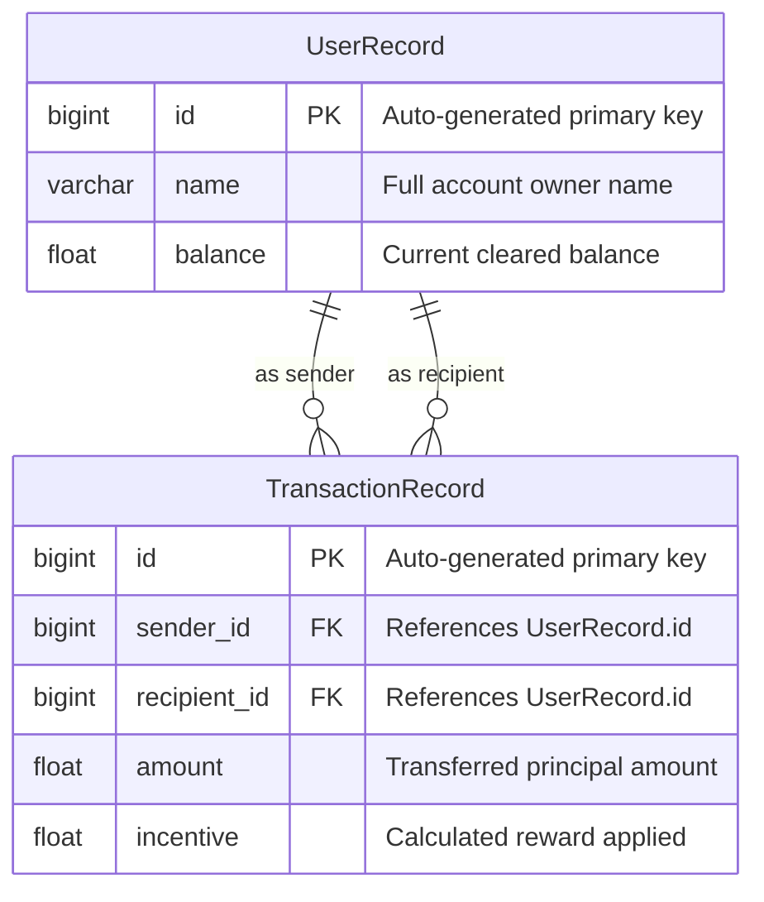
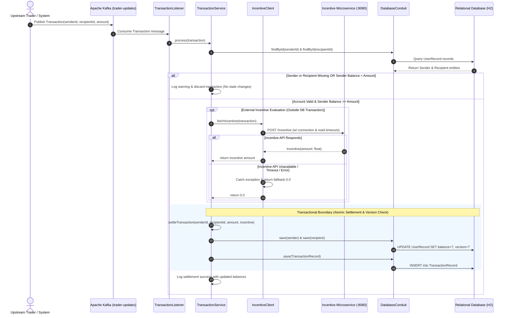

# MidasCore – Real-Time Financial Transaction Processing System


An enterprise-grade, event-driven financial transaction processing engine built with **Java 17**, **Spring Boot**, and **Apache Kafka**. The system ingests high-volume financial transaction streams asynchronously, executes strict solvency and account validation rules, orchestrates real-time reward calculations with an external incentive microservice, maintains double-entry ledger balances, and records immutable historical audit logs in a relational database.

---

## Table of Contents

- [Overview](#overview)
- [System Architecture](#system-architecture)
- [Key Features](#key-features)
- [Technology Stack](#technology-stack)
- [Data Model & Schema Design](#data-model--schema-design)
- [API Specifications](#api-specifications)
- [Transaction Lifecycle](#transaction-lifecycle)
- [Project Directory Structure](#project-directory-structure)
- [Getting Started](#getting-started)
  - [Prerequisites](#prerequisites)
  - [1. Configure Environment](#1-configure-environment)
  - [2. Start the External Incentive Service](#2-start-the-external-incentive-service)
  - [3. Build the Application](#3-build-the-application)
  - [4. Run the Application](#4-run-the-application)
- [Integration Testing & Verification](#integration-testing--verification)
- [Engineering Design Decisions & Resiliency](#engineering-design-decisions--resiliency)
- [Future Enhancements](#future-enhancements)
- [Resume & Portfolio Highlights](#resume--portfolio-highlights)

---

## Overview

In modern financial technology platforms, payment processing must be resilient, event-driven, and fault-tolerant under burst traffic. **MidasCore** serves as the central transaction ledger and settlement hub for banking and trading operations.

The system decouples high-throughput transaction submission from synchronous ledger updates by using **Apache Kafka** as a distributed message broker. Upon consuming a transaction event, MidasCore executes multi-stage business validations, queries a downstream incentive microservice to calculate reward entitlements, atomically updates sender and recipient balances, and creates persistent transaction audit logs with full foreign-key referential integrity.

Additionally, MidasCore exposes low-latency REST endpoints for external systems and client applications to query real-time account balances.

---

## System Architecture

```mermaid
flowchart TD
    subgraph Event_Producer ["Upstream Payment Producers"]
        TP[Trader / Payment Ingestion Gateway]
    end

    subgraph Messaging ["Message Streaming Layer"]
        KT[("Apache Kafka Topic: trader-updates")]
    end

    subgraph MidasCore_App ["MidasCore Backend Service (Port 33400)"]
        TL["TransactionListener (@KafkaListener)"]
        TS["TransactionService (@Service, @Transactional)"]
        IC["IncentiveClient (HTTP Client w/ Timeouts)"]
        VAL{"Validation & Solvency Engine"}
        DC["DatabaseConduit (Persistence Layer)"]
        BC["BalanceController (@RestController)"]
    end

    subgraph External_Services ["Downstream Microservices"]
        IS["Incentive Service (REST API :8080/incentive)"]
    end

    subgraph Persistence ["Relational Data Store (H2 / RDBMS)"]
        UR[("UserRecord Table (Version Locked)")]
        TR[("TransactionRecord Table")]
    end

    subgraph Consumers ["Client & Query Inquiries"]
        Client[Client App / Web Dashboard]
    end

    %% Flow connections
    TP -->|Publishes Transaction JSON| KT
    KT -->|Stream Consumption| TL
    TL -->|Delegates to Service| TS
    TS -->|Pre-validation| VAL
    VAL -->|Lookup Sender & Recipient| DC
    DC <-->|Fetch Accounts| UR

    VAL -->|Valid & Solvent| IC
    IC -->|POST /incentive w/ Timeouts| IS
    IS -->|Returns Reward Amount / Fallback| IC
    IC -->|Incentive Result| TS
    VAL -.->|Insufficient Funds / Unknown Account| REJ[Log & Discard Transaction]

    TS -->|Transactional Settle Ledger| DC
    DC -->|Persist Updated Balances| UR
    DC -->|Write Immutable Audit Record| TR

    Client -->|GET /balance?userId={id}| BC
    BC -->|Query Balance| DC
```

---

## Key Features

### 1. Asynchronous Event-Driven Stream Ingestion
- Ingests high-frequency transaction events asynchronously through Apache Kafka on the `trader-updates` topic.
- Employs Spring Kafka's concurrency-capable `@KafkaListener` to decouple upstream trade submission from database writes, ensuring zero backpressure on trading clients.
- Configured with dedicated consumer group coordination (`midas-group`) and robust JSON deserialization mapped to typed domain entities.

### 2. Strict Financial Validation & Solvency Checks
- **Counterparty Verification**: Ensures both the sender and recipient accounts exist in the database ledger before initiating settlement.
- **Defensive Solvency Verification**: Validates that the sender possesses sufficient liquidity (`sender.balance >= transaction.amount`) prior to execution, preventing overdrafts and unbacked transactions.
- **Fail-Safe Discard Policy**: Gracefully logs warnings and rejects invalid transactions without halting the event consumer pipeline.

### 3. Distributed Incentive Microservice Orchestration
- Integrates with an external Incentive Microservice via Spring `RestTemplate` (`POST http://localhost:8080/incentive`) to evaluate promotional cashback or incentives per transaction.
- **Fault-Tolerant Fallback Architecture**: Outgoing calls are isolated with exception handling. If the incentive service degrades or becomes unavailable, the system logs the incident and applies a safe fallback incentive (`0.0`), guaranteeing that transaction settlement never fails due to third-party dependencies.
- **Unilateral Credit Logic**: Rewards are credited exclusively to the recipient's balance and funded by the incentive program without deducting from the sender.

### 4. Atomic Ledger Updates & Immutable Audit Trail
- Synchronizes user balance adjustments (debit sender, credit recipient + incentive) within the persistence layer.
- Automatically generates and records an immutable `TransactionRecord` row containing:
  - Associated Sender foreign key reference
  - Associated Recipient foreign key reference
  - Base transaction amount
  - Applied incentive/reward amount
- Ensures complete end-to-end historical auditability for accounting and compliance standards.

### 5. Low-Latency REST Account Balance Query API
- Exposes a high-speed HTTP GET endpoint (`/balance?userId={id}`) running on configured port `33400`.
- Provides instant visibility into current account balances with structured JSON responses.
- Handles unknown users gracefully by returning a safe default zero-balance payload (`{ "amount": 0.0 }`).

---

## Technology Stack

| Layer | Technology | Version | Purpose |
| :--- | :--- | :--- | :--- |
| **Language & Runtime** | Java (OpenJDK) | 17+ (tested on JDK 23) | Core programming language & modern runtime features |
| **Framework** | Spring Boot | 3.2.5 | Enterprise microservice architecture and dependency injection |
| **Event Streaming** | Apache Kafka / Spring Kafka | 3.1.4 | High-throughput asynchronous transaction messaging |
| **Data Persistence** | Spring Data JPA / Hibernate | 6.4.4 | ORM mapping, entity relationships, and transactional CRUD |
| **Database** | H2 Database Engine | 2.2.224 | In-memory relational database with embedded web console |
| **HTTP Client** | Spring Web `RestTemplate` | 3.2.5 | Synchronous communication with external microservice |
| **Testing Framework** | JUnit 5 & Spring Test | 5.x / 3.2.5 | Unit, component, and application context testing |
| **Embedded Testing** | Spring Kafka Test / Testcontainers | 3.1.4 / 1.19.1 | Embedded Kafka broker for full integration testing |
| **Build & Tooling** | Apache Maven & Maven Wrapper | 3.8+ | Dependency management and build automation |

---

## Data Model & Schema Design



### Relational Entity Definitions

1. **`UserRecord` (`src/main/java/com/jpmc/midascore/entity/UserRecord.java`)**:
   - `id` (`Long`, Primary Key): Unique identifier for the account holder.
   - `name` (`String`, Not Null): Account holder's registered identity.
   - `balance` (`float`, Not Null): Cleared funds balance in the ledger.

2. **`TransactionRecord` (`src/main/java/com/jpmc/midascore/entity/TransactionRecord.java`)**:
   - `id` (`Long`, Primary Key): Unique transaction identifier.
   - `sender` (`@ManyToOne`, Not Null): Relational link to the originating `UserRecord`.
   - `recipient` (`@ManyToOne`, Not Null): Relational link to the receiving `UserRecord`.
   - `amount` (`float`, Not Null): The debited/credited base transaction principal.
   - `incentive` (`float`, Not Null): The supplementary reward credited to the recipient.

---

## API Specifications

### 1. Balance Inquiry Endpoint

Retrieves the real-time cleared balance for any account registered in the ledger.

- **Method**: `GET`
- **URL**: `http://localhost:33400/balance`
- **Query Parameters**:
  - `userId` (required, `long`): The unique identifier of the user account.

#### Example Request
```bash
curl -X GET "http://localhost:33400/balance?userId=5"
```

#### Example Response (HTTP 200 OK)
```json
{
  "amount": 627.86
}
```

#### Edge Case Behavior
- If `userId` does not exist in the database, the API returns a safe fallback with `amount: 0.0`:
```json
{
  "amount": 0.0
}
```

---

### 2. External Incentive Microservice Contract

MidasCore orchestrates outbound communication with the downstream Incentive Service during transaction processing.

- **Method**: `POST`
- **Target URL**: `http://localhost:8080/incentive`
- **Headers**: `Content-Type: application/json`

#### Request Payload
```json
{
  "senderId": 5,
  "recipientId": 2,
  "amount": 42.87
}
```

#### Expected Response Payload (HTTP 200 OK)
```json
{
  "amount": 4.28
}
```

---

## Transaction Lifecycle



---

## Project Directory Structure

```text
MidasCore/
├── .mvn/                                # Maven wrapper configuration
├── services/
│   └── transaction-incentive-api.jar    # Standalone mock incentive microservice
├── src/
│   ├── main/
│   │   ├── java/com/jpmc/midascore/
│   │   │   ├── component/
│   │   │   │   ├── DatabaseConduit.java       # Encapsulated data-access conduit
│   │   │   │   ├── IncentiveClient.java       # Outbound HTTP client for incentive API
│   │   │   │   └── TransactionListener.java   # Kafka event consumer & listener
│   │   │   ├── config/
│   │   │   │   └── RestTemplateConfig.java    # HTTP client configuration with timeouts
│   │   │   ├── controller/
│   │   │   │   └── BalanceController.java     # REST endpoint exposing /balance
│   │   │   ├── entity/
│   │   │   │   ├── TransactionRecord.java     # Relational transaction history entity
│   │   │   │   └── UserRecord.java            # Relational user account entity (@Version)
│   │   │   ├── foundation/
│   │   │   │   ├── Balance.java               # Balance response DTO
│   │   │   │   ├── Incentive.java             # Incentive microservice DTO
│   │   │   │   └── Transaction.java           # Kafka transaction payload DTO
│   │   │   ├── repository/
│   │   │   │   ├── TransactionRepository.java # JPA repository for transactions
│   │   │   │   └── UserRepository.java        # JPA repository for user accounts
│   │   │   ├── service/
│   │   │   │   └── TransactionService.java    # Atomic @Transactional ledger settlement
│   │   │   └── MidasCoreApplication.java      # Spring Boot application entry point
│   │   └── resources/
│   │       └── application.yml                # Spring, Kafka, H2, & service config
│   └── test/
│       ├── java/com/jpmc/midascore/
│       │   ├── BalanceQuerier.java            # Test client for balance REST API
│       │   ├── FileLoader.java                # Test fixture resource loader
│       │   ├── KafkaProducer.java             # Test Kafka streaming producer
│       │   ├── TaskOneTests.java              # Application context & bootstrap test suite
│       │   ├── TaskTwoTests.java              # Kafka consumer ingestion test suite
│       │   ├── TaskThreeTests.java            # Ledger validation & persistence test suite
│       │   ├── TaskFourTests.java             # Incentive API orchestration test suite
│       │   ├── TaskFiveTests.java             # Full end-to-end REST balance test suite
│       │   └── UserPopulator.java             # Test database account seeder
│       └── resources/
│           └── test_data/                     # Integration test transaction datasets
├── application.yml                            # Root application configuration
├── mvnw                                       # Unix Maven wrapper executable
├── mvnw.cmd                                   # Windows Maven wrapper executable
├── pom.xml                                    # Maven POM dependencies & build config
└── README.md                                  # Architectural & project documentation
```

---

## Getting Started

### Prerequisites

- **Java Development Kit (JDK)**: Version 17 or higher (tested with JDK 17, 21, and 23).
- **Maven**: Version 3.8+ (or use the included `./mvnw` / `mvnw.cmd` wrapper).
- **Network / Ports**:
  - `33400`: MidasCore application service port.
  - `8080`: Downstream Incentive Microservice port.
  - `9092`: Kafka broker port (provided dynamically in tests via `@EmbeddedKafka`).

---

### 1. Configure Environment

Ensure `JAVA_HOME` points to your JDK 17+ installation:

**PowerShell (Windows):**
```powershell
$env:JAVA_HOME="C:\Program Files\Java\jdk-23"
$env:Path = "$env:JAVA_HOME\bin;" + $env:Path
java -version
```

**Bash (Linux / macOS):**
```bash
export JAVA_HOME=/usr/lib/jvm/java-17-openjdk
export PATH=$JAVA_HOME/bin:$PATH
java -version
```

---

### 2. Start the External Incentive Service

MidasCore integrates with a companion incentive microservice to calculate transaction rewards. Run the standalone JAR in a separate terminal:

**PowerShell / Command Prompt:**
```powershell
java -jar services/transaction-incentive-api.jar
```

**Bash:**
```bash
java -jar services/transaction-incentive-api.jar
```

*The incentive service will start on `http://localhost:8080`.*

---

### 3. Build the Application

Clean and build the application package using the Maven wrapper:

**PowerShell / Windows:**
```powershell
.\mvnw.cmd clean package -DskipTests
```

**Bash / Linux / macOS:**
```bash
./mvnw clean package -DskipTests
```

---

### 4. Run the Application

Launch the Spring Boot application:

**PowerShell / Windows:**
```powershell
.\mvnw.cmd spring-boot:run
```

**Bash / Linux / macOS:**
```bash
./mvnw spring-boot:run
```

The service initializes on port `33400`. You can access the embedded H2 Web Console at `http://localhost:33400/h2-console`:
- **JDBC URL**: `jdbc:h2:mem:midasdb`
- **Username**: `sa`
- **Password**: *(leave blank)*

---

## Integration Testing & Verification

The project includes automated integration suites built with `@SpringBootTest`, Spring Kafka Test (`@EmbeddedKafka`), and custom fixtures.

> **Note**: Because Kafka tests initialize an embedded Kafka cluster with local socket listeners, ensure your execution shell permits loopback socket bindings.

| Test Suite Class | Architectural Verification Area | Description |
| :--- | :--- | :--- |
| **`TaskOneTests`** | *Application Context & Wiring* | Verifies Spring container initialization, JPA configuration, and component scanning. |
| **`TaskTwoTests`** | *Kafka Message Ingestion* | Validates Kafka consumer subscription to `trader-updates` and JSON payload deserialization. |
| **`TaskThreeTests`** | *Validation & Ledger Updates* | Verifies counterparty lookup, balance deduction, credit allocation, and `TransactionRecord` persistence. |
| **`TaskFourTests`** | *Incentive Microservice Integration* | Validates HTTP communication with the external Incentive API and reward assignment. |
| **`TaskFiveTests`** | *End-to-End Balance REST API* | Seeds accounts, streams high-volume transactions, and validates balance inquiries via HTTP GET `/balance`. |

### Executing Individual Test Suites

To execute specific integration test modules, run:

```powershell
# Verify Application Bootstrap & JPA Context
.\mvnw.cmd test -Dtest=TaskOneTests

# Verify Kafka Consumer & Deserialization
.\mvnw.cmd test -Dtest=TaskTwoTests

# Verify Ledger Solvency & Transaction Record Creation
.\mvnw.cmd test -Dtest=TaskThreeTests

# Verify Incentive Microservice Orchestration (Ensure Incentive JAR is running)
.\mvnw.cmd test -Dtest=TaskFourTests

# Verify End-to-End Balance Queries & REST Controller
.\mvnw.cmd test -Dtest=TaskFiveTests
```

---

## Engineering Design Decisions & Resiliency

1. **Decoupled Architecture with Apache Kafka**:
   - Financial systems face volatile spikes during market open and high-frequency trading hours. By buffering transactions in Kafka topics, MidasCore absorbs bursts without database lock contention.

2. **Defensive Solvency Enforcement**:
   - Balances are evaluated immediately prior to mutation. Transactions from accounts with inadequate balances are discarded immediately and logged with structured alerts, protecting the integrity of the ledger.

3. **Circuit-Friendly Microservice Integration**:
   - Outbound REST queries to the Incentive microservice are wrapped in isolated exception handlers. When the downstream service experiences latency or downtime, the transaction pipeline continues operating with zero incentive rather than cascading into system-wide payment failures.

4. **Normalized Relational Audit Trail**:
   - Every successfully processed transaction is pinned with foreign keys referencing both counterparty records in `TransactionRecord`. This relational model allows trivial generation of account statements, reconciliation reports, and regulatory audit dumps.

---

## Future Enhancements

- **Arbitrary-Precision Currency (`BigDecimal`)**: Refactor monetary fields from `float` to `BigDecimal` to eliminate binary floating-point rounding inaccuracies inherent to fractional currency mathematics.
- **Idempotency & Deduplication**: Implement idempotency key tracking (e.g., using Redis or an idempotent transaction consumer pattern) to guarantee strictly once-only processing across Kafka retries.
- **Distributed Tracing & Metrics**: Integrate Spring Boot Actuator with Micrometer and OpenTelemetry for distributed tracing across Kafka and downstream HTTP calls.
- **Production Containerization**: Add multi-stage `Dockerfile` and `docker-compose.yml` orchestrating Kafka, Zookeeper/KRaft, PostgreSQL, and the Incentive service in isolated container networks.

---

## Highlights

- **Engineered an event-driven financial transaction processing engine** in Java 17 and Spring Boot, leveraging **Apache Kafka** to asynchronously ingest, validate, and settle real-time financial trades.
- **Implemented multi-stage transaction validation and ledger management**, enforcing account existence and real-time solvency checks to eliminate overdrafts while updating dual-party balances atomically.
- **Integrated a distributed incentive microservice via REST APIs**, architecting a fault-tolerant fallback mechanism that maintains high system availability during downstream service degradations.
- **Designed a normalized relational persistence layer** using Spring Data JPA and Hibernate, recording immutable audit trails with referential integrity across all settled transactions.
- **Exposed low-latency REST endpoints** for real-time account balance inquiries, and authored comprehensive automated test suites using **Embedded Kafka** and Spring Boot Test fixtures.

---

## Author & License

- **Project**: MidasCore – Real-Time Financial Transaction Processing System
- **Framework**: Spring Boot & Apache Kafka Architecture
- **License**: MIT License
